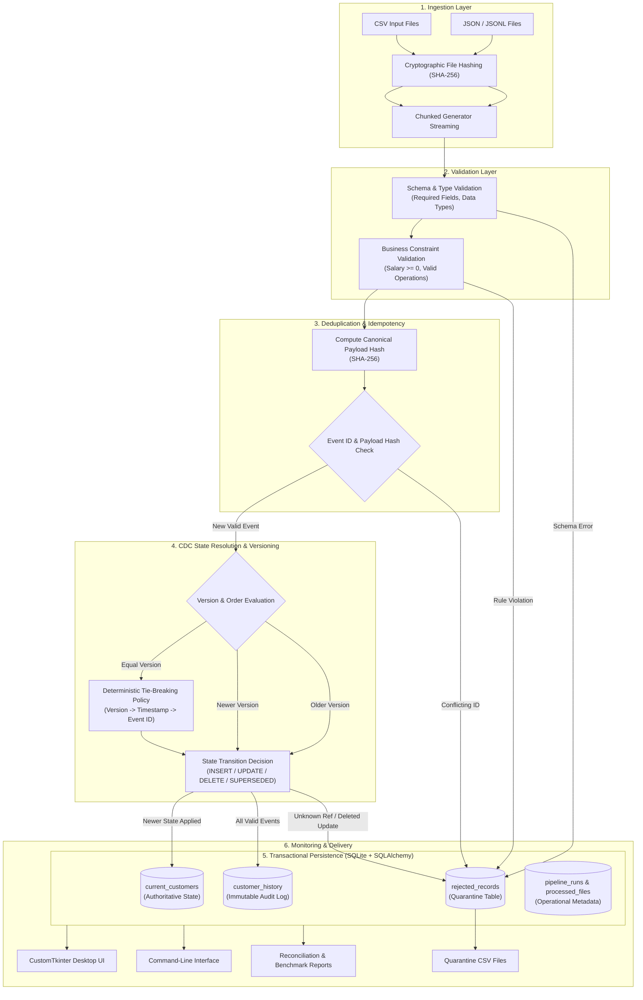

# CDC Data Pipeline Manager - Architecture Specification

## Overview

The **CDC Data Pipeline Manager** is an autonomous, transactional Change Data Capture processing framework. It converts raw customer event streams into:
1. **Current State:** The latest point-in-time snapshot of valid customer entities.
2. **Audit History:** An append-only chronological log of all accepted CDC events.
3. **Quarantine:** An isolated repository of malformed, invalid, or conflicting records with explicit root causes.

---

## Architectural Flow Diagram

---

## Detailed Pipeline Stages

### Stage 1: Ingestion & Streaming
- **File Hashing:** Calculates a SHA-256 hash across the entire file. Registered in `processed_files` for auditability and idempotency.
- **Chunked Generator:** Instead of loading multi-gigabyte files into RAM, the ingestion engine uses pandas/generator chunks of configurable size (default 5,000 records). Memory utilization stays below 300MB even for 100,000+ records.

### Stage 2: Schema & Business Validation
- Verifies existence and types of: `event_id`, `customer_id`, `operation`, `version`, `event_timestamp`.
- Normalizes operations into uppercase (`INSERT`, `UPDATE`, `DELETE`).
- Rejects non-numeric, negative salaries or missing names/cities for INSERT and UPDATE operations.

### Stage 3: Deduplication & Idempotency
- **Canonical Hash:** Computes `SHA-256(customer_id | operation | name | city | salary | version | timestamp)`.
- **Exact Duplicates:** If an incoming `event_id` is encountered with the identical payload hash, the event is skipped idempotently, incrementing `duplicate_count` with zero side-effects.
- **Conflicting Event IDs:** If an incoming `event_id` matches an existing event with a *different* payload, the record is flagged as a conflict and quarantined.

### Stage 4: Event Ordering & Tie-Breaking Policy
- **Primary Ordering:** `version` column.
- **Newer Events (`version > current`):** Overwrite current customer state and record as `APPLIED` in history.
- **Older Events (`version < current`):** Are preserved in `customer_history` as `SUPERSEDED_OUT_OF_ORDER`. They never alter the current customer state, ensuring older events cannot resurrect soft-deleted customers or revert updated values.
- **Equal Versions (`version == current`):**
  1. Newer `event_timestamp` wins.
  2. If timestamp is identical, lexicographical comparison `event_id > last_event_id` breaks the tie deterministically.

### Stage 5: Atomic Batch Persistence
- Database operations are wrapped inside a single SQLAlchemy session transaction per batch.
- High-performance SQLite PRAGMAs (`WAL` mode, `synchronous = NORMAL`, `cache_size = -64000`) allow batch writing of thousands of records per second without database locks.

